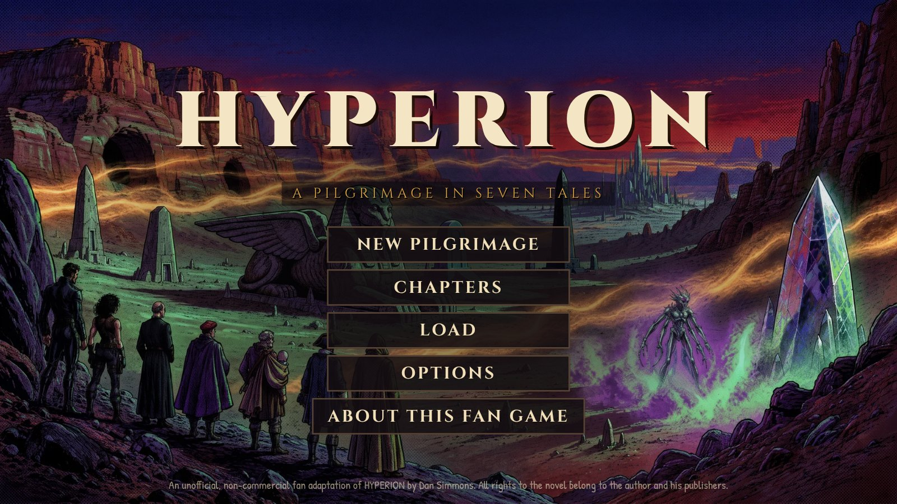
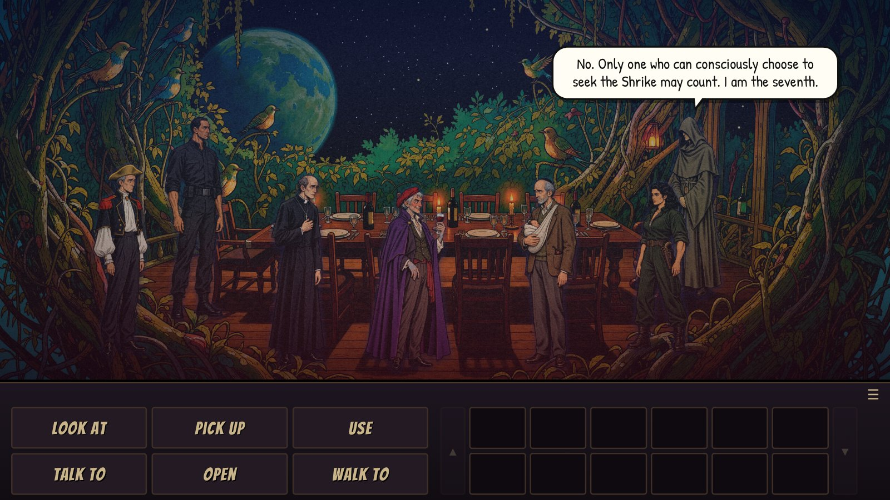
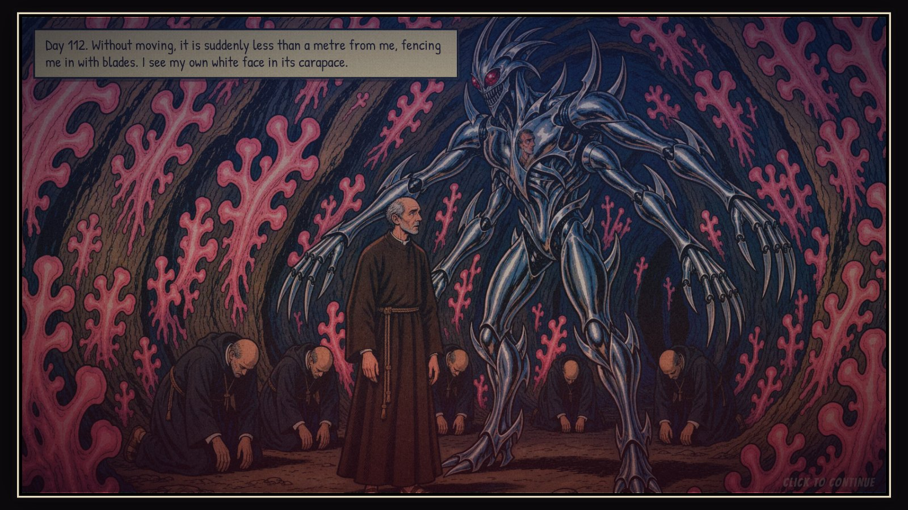
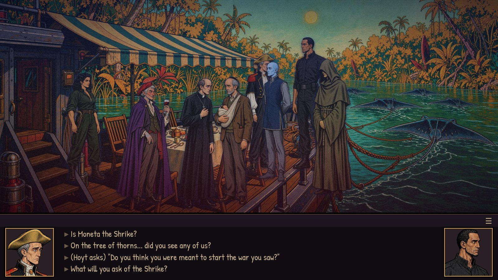
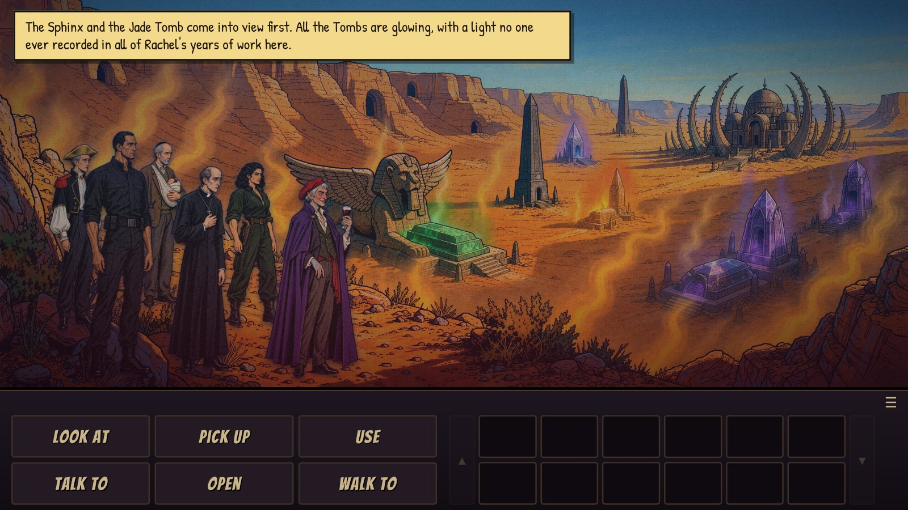

# HYPERION — A Pilgrimage in Seven Tales

*An unofficial, non-commercial fan adaptation of **Hyperion** (1989) by **Dan Simmons**, made as a playable
proof of concept for the rights holders.*



Seven pilgrims cross Hyperion toward the Time Tombs and the Shrike. Each tells the story of why they came.
This classic point-and-click adventure follows the novel's structure chapter by chapter: you play **the Consul** between the
tales, and you play **the protagonist of each tale** inside it.

| Part | Frame (play as the Consul) | Tale (play as…) |
|---|---|---|
| Prologue | The swamp world, Gladstone's fatline message, lift-off | — |
| I | The treeship *Yggdrasill*: dinner, the vote, the lots; afterwards, Hoyt's pod | **The Priest's Tale** — Father Paul Duré |
| II | Landing at Keats, Theo Lane, the Shrike Temple ruins, Cicero's, the *Benares* | **The Soldier's Tale** — Fedmahn Kassad |
| III | The burned port of Naiad | **The Poet's Tale** — Martin Silenus |
| IV | Edge, the bonfire, the crewless windwagon; the *Yggdrasill* burns | **The Scholar's Tale** — Sol Weintraub |
| V | Masteen vanishes; Pilgrims' Rest; the tramway over the Bridle Range | **The Detective's Tale** — Brawne Lamia |
| VI | Chronos Keep; the seventh pilgrim; judgement | **The Consul's Tale** — Merin Aspic, then the Consul |
| Epilogue | The descent to the Valley of the Time Tombs | — |

## Screenshots

| | |
|---|---|
|  |  |
| Chapter I: dinner on the treeship *Yggdrasill*, where Het Masteen names himself the seventh pilgrim. | The Priest's Tale: Father Duré meets the Shrike in the cruciform cave (comic panel). |
|  |  |
| Chapter II: the pilgrims question Kassad aboard the barge *Benares* (dialogue choices). | Epilogue: the six pilgrims reach the Valley of the Time Tombs. |

## Features
- SCUMM-style verbs (Look, Pick up, Use, Talk, Open, Walk), inventory and item combinations, dialogue trees.
- Art direction "Midnight" (gritty 80s sci-fi magazine look; Options → Art style can switch to Classic).
- Comic-book presentation: speech balloons, narration captions, full-screen comic panels with slow camera moves.
- **English and Spanish**, switchable at any time (Options).
- Every event follows the novel's order and outcome. Anything added only connects scenes so they can be played; each
  tale's design notes list those additions (`docs/design/*.md`). All dialogue and narration is an original retelling:
  no prose from the novel is reproduced.
- Mature themes (violence, grief, body horror, adult relationships) are present but implied, never explicit.
- An original 14-cue soundtrack (main theme, one cue per tale, journey, Keats, Chronos Keep, finale, Shrike sting),
  generated with Runway music models and streamed per chapter, over ambience and effects synthesized live with WebAudio.
  The Consul's piano plays the opening of
  Rachmaninoff's Prelude in C-sharp minor (public domain).
- Save/load (5 slots and autosave), chapter select (unlocks as you play; Options → *reviewer mode* unlocks everything).
- Runs in any modern desktop browser, also on tablets. No build step, no server code.

## Controls
Left-click: walk / default action · Right-click: look · **Tab**: show hotspots · Space/Enter: skip a line ·
Esc: menu · L/P/U/T/O: select verbs · 1–9: pick a dialogue option.

## Run locally
```bash
python3 -m http.server 8123   # then open http://localhost:8123
```
Useful URL parameters: `?lang=es`, `?chapter=ch3`, `?tale=poet`, `?debug` (shows hotspots and walk areas).

## Deploy to Netlify
The repository root is the site. `netlify.toml` already sets `publish = "."` with no build command:
connect the repo in Netlify (or drag-and-drop the folder) and deploy. Consider password-protecting the site
(Netlify → Site settings → Visitor access) while it's being pitched.

## Project layout
```
index.html, css/style.css          shell and comic-styled UI
js/engine/                         engine (scenes, pathfinding, verbs, dialogue, panels, saves, i18n, audio, menus)
js/content/chapters/*.js           the Consul's frame story (Prologue, I–VI, Epilogue)
js/content/tales/*.js              the six tales
assets/{bg,panels,chars,portraits,items,fonts}
docs/story-bible.md                research outline of the novel used for fidelity (paraphrased)
docs/AUTHORING.md, docs/ART.md     how to write content / generate art
docs/design/*.md                   per-tale design notes, including every invented "glue" element
tests/playthrough.mjs              automated Playwright playthroughs (tests/walkthroughs/*.json)
tools/                             asset processing, lint, grid overlay
_old/                              the previous prototype that lived in this repository
```

## Testing
```bash
python3 -m http.server 8123 &
node tests/playthrough.mjs                 # every chapter, English
node tests/playthrough.mjs --lang=es       # every chapter, Spanish
node tests/playthrough.mjs priest soldier  # individual tales
python3 tools/lint.py                      # untranslated strings, missing assets
```

## Credits & rights
*Hyperion* and all its characters, places and events © Dan Simmons; published by Doubleday/Bantam (US) and others.
This is a fan work, not affiliated with or endorsed by the author or publishers, and is not for sale.
Illustrations were generated with Higgsfield image models under the art direction in `docs/ART.md`.
Fonts: Patrick Hand, Cinzel, Bangers (SIL Open Font License, see `assets/fonts/`).
